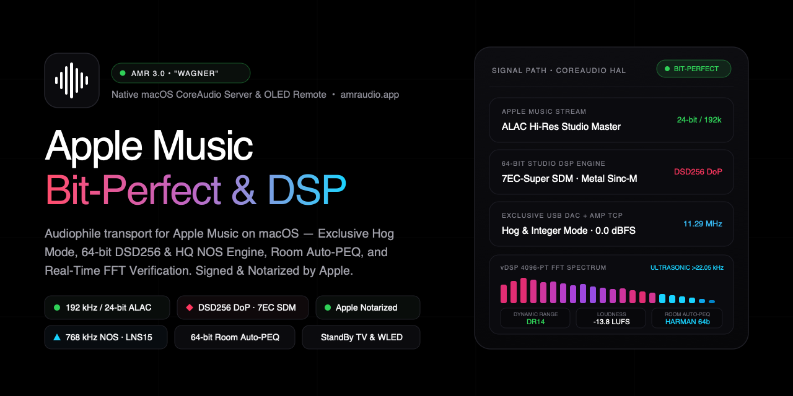
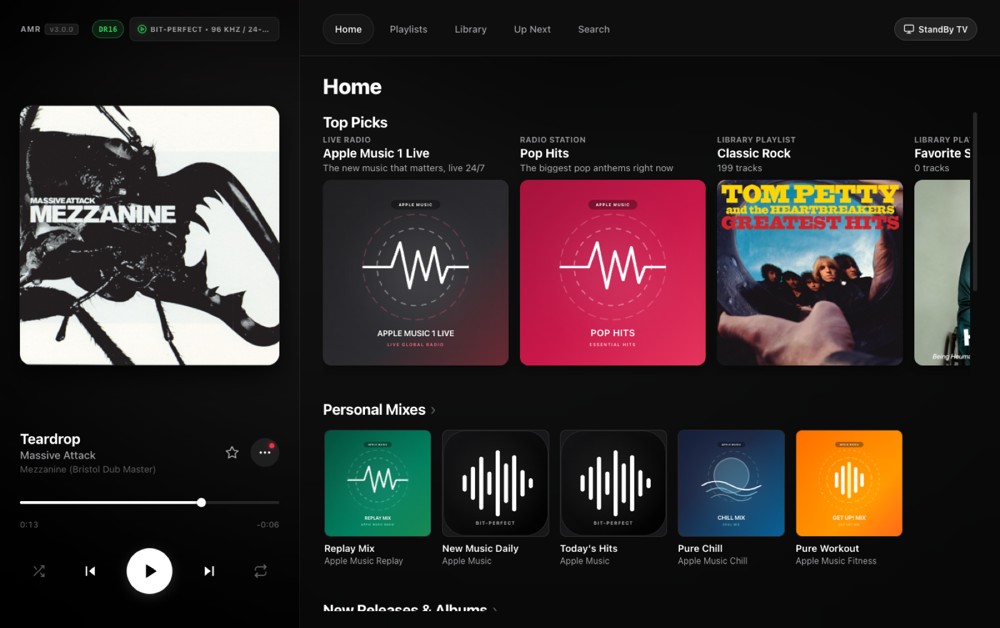
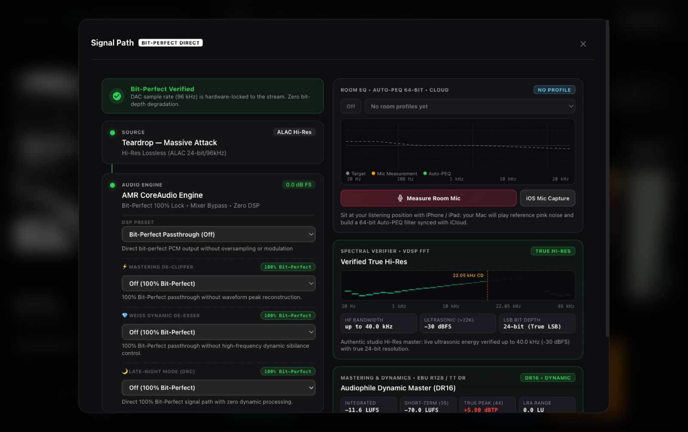
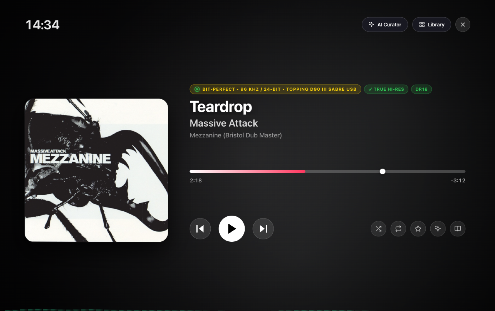
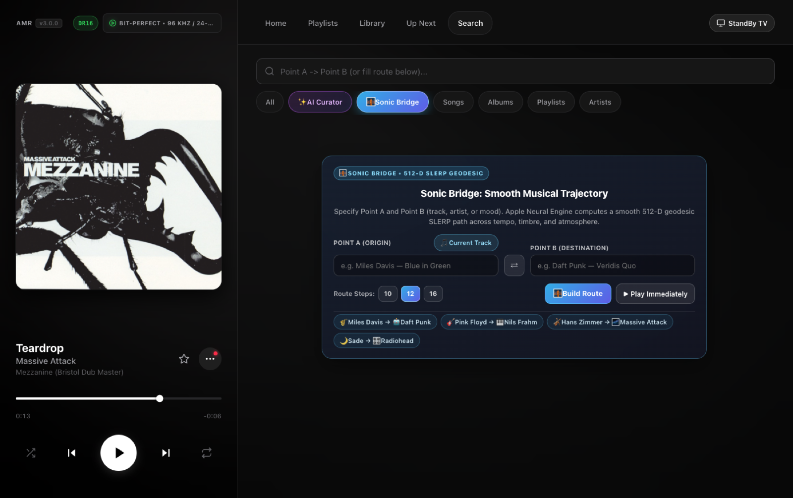

<div align="center">



<br>

# Apple Music Remote (AMR)

**Audiophile Bit-Perfect CoreAudio Server, 64-Bit Studio DSP & Pure OLED Remote for Apple Music on macOS**

[](https://github.com/1orgar/amr/actions/workflows/ci.yml)
[](https://github.com/1orgar/amr/releases/latest)
[](https://github.com/1orgar/homebrew-tap)
[](https://github.com/1orgar/amr/releases/latest)
[](https://www.apple.com/macos/)
[](https://developer.apple.com/documentation/apple-silicon)
[](LICENSE)

[**🌐 Website & Live Signal Lab**](https://amraudio.app) · [**⬇ Download Universal DMG**](https://github.com/1orgar/amr/releases/latest) · [**🎛 64-Bit DSP Engine Guide**](docs/DSP_AUDIO_ENGINE.md) · [**🗺 Roadmap**](ROADMAP.md) · [**🔌 WebSocket & HTTP API**](#-api--protocols)

</div>

---

## 🖼 Visual Overview

<table>
  <tr>
    <td width="50%" valign="top">
      <a href="docs/images/screen-desktop-player.png">
        
      </a>
      <p align="center"><sub><b>Pure OLED Split-View Remote</b> — Live DR16 &amp; DAC rate telemetry, personalized stations, and zero-latency 60 fps controls.</sub></p>
    </td>
    <td width="50%" valign="top">
      <a href="docs/images/screen-signal-path.png">
        
      </a>
      <p align="center"><sub><b>Audiophile Signal Path Inspector</b> — Roon-style chain, 64-bit Studio DSP presets, iPhone Room Auto-PEQ, and vDSP FFT True Hi-Res verification.</sub></p>
    </td>
  </tr>
  <tr>
    <td width="50%" valign="top">
      <a href="docs/images/screen-standby-tv.png">
        
      </a>
      <p align="center"><sub><b>Fullscreen StandBy / TV Mode</b> — Motion artwork, distance-readable typography, live 60 fps RTA spectrum, and 16-zone WLED Ambilight.</sub></p>
    </td>
    <td width="50%" valign="top">
      <a href="docs/images/screen-ai-sonic-bridge.png">
        
      </a>
      <p align="center"><sub><b>On-Device AI Curator &amp; Sonic Bridge</b> — 512-D SLERP geodesic musical trajectories and Infinite AI Wave powered by Apple Neural Engine.</sub></p>
    </td>
  </tr>
</table>

---

## ⚡ Why AMR?

macOS resamples all system audio to a single fixed sample rate inside `coreaudiod`, and Apple offers no lossless headless remote protocol for controlling `Music.app` on a dedicated Mac mini connected to an external Hi-Fi DAC.

**Apple Music Remote (AMR)** solves both problems in a single native Swift menu bar server (~0% idle CPU, zero Electron, zero virtual audio drivers):

* **100% Bit-Perfect Direct Mode** — Automatically switches your hardware DAC clock (`44.1 – 192 kHz`) bit-for-bit to match each Apple Music track, enforces `100% Volume Lock`, and verifies ultrasonic content in real time via `vDSP` FFT so upsampled "fake Hi-Res" masters never go unnoticed.
* **Optional 64-Bit Studio DSP (`Exclusive Hog Mode`)** — Engage `DSD64–DSD256 DoP` (`7EC` 7th-order Sigma-Delta with Viterbi Trellis), synchronous `2x–16x` oversampling up to `768 kHz` (`Accelerate AMX FP64` 65k taps / `Metal GPU df64` 262k taps + `LNS15` 15th-order noise shaper for R2R NOS DACs), 64-bit **Room Auto-PEQ** measured straight from your iPhone mic, **Pre-DSP De-Clipper & Weiss De-Esser**, or **Late-Night DRC** — with an instant 1-click return to `100% Bit-Perfect Bypass`.
* **Pure `#000000` OLED Web Remote (PWA)** — Control playback, playlists, library, AI curation, digital booklets, and hardware amplifier volume from any iPhone, iPad, Android phone, desktop browser, or living-room TV over LAN with zero app-store friction.
* **Signed, Notarized & Zero-Keychain Vault** — Distributed as an Apple Developer ID signed & notarized Universal 2 `.dmg` (`arm64` + `x86_64`) with a local `AES-256-GCM` `CryptoKit` secret store — **zero Gatekeeper warnings and zero macOS Keychain password prompts**.

---

## ✨ Key Capabilities (v3.0 "Wagner")

### 🎧 Bit-Perfect CoreAudio HAL & Hybrid 64-Bit Studio DSP
* **Automatic Hardware Sample Rate Sync**: Instant CoreAudio clock switching across `44.1`, `48`, `88.2`, `96`, `176.4`, and `192 kHz` in `Bit-Perfect Passthrough`, plus `DAC Muting Guard` (`Pre-Mute → PLL Lock → Unmute`) for click-free relay transitions.
* **Exclusive `Hog Mode` + Non-Mixable Integer (`0x4c`)**: Lock-free `SPSCAtomicRingBuffer` + `RealtimeMachWorker` captures `Music.app` via `AudioProcessTapService` and drives your external USB DAC directly, isolating it from macOS system alerts and the 32-bit OS mixer.
* **`DSD64 / DSD128 / DSD256 DoP` (`7EC` Modulator)**: 7th-order Chebyshev Sigma-Delta modulator (`7EC-Transient`, `7EC-Balanced`, `7EC-Super`) with **Viterbi Trellis lookahead (`M = 4..16`)** and ISI regularizer up to `11.29 / 12.29 MHz` (`DoP 705.6 / 768 kHz`).
* **`HQ PCM NOS` up to `705.6 / 768 kHz`**: Multi-stage `Accelerate AMX FP64` (**65,536 taps**) and `Metal GPU Overlap-Save df64` (**262,144 taps**) Linear-Phase / Minimum-Phase Sinc filters paired with a 15th-order psychoacoustic **`LNS15`** noise shaper (`< -165 dBFS` audible floor — tailored for discrete R2R / Multibit ladder DACs).
* **3-Stage Hardware USB DAC Verifier**: Automatically inspects bus transport, integer bit depth (`≥ 24-bit`), and supported rate grids — blocking `DSD DoP` / `NOS` on built-in Mac speakers, AirPlay, Bluetooth, HDMI, or 16-bit headsets.
* **Full Technical Reference**: Read [**`docs/DSP_AUDIO_ENGINE.md`**](docs/DSP_AUDIO_ENGINE.md) for filter math, preset architecture, and acoustic tuning.

### 🔬 Signal Path Inspector, FFT Spectral Verifier & Mastering Telemetry
* **Real-Time `vDSP` FFT Hi-Res Verifier (`SpectralIntegrityAnalyzer`)**: 4096-point Hann-windowed FFT + LSB bit-depth scanner classifies streams into `TRUE HI-RES`, `FAKE HI-RES • 22K CUT`, `UPSAMPLED 48K`, `16-BIT PADDED`, or `CD LOSSLESS` with two-tier persistent disk caching.
* **Live Mastering Telemetry**: Real-time **TT Dynamic Range (`DR4–DR16+`)**, **EBU R128 Integrated & Short-Term `LUFS`**, **4× Oversampled `True Peak (dBTP)` & ISP Clipping Guard**, and **Stereo Phase Correlation (`-1..+1`)**.
* **64-Bit Room Acoustic Correction (`RoomAcousticService` + `Auto-PEQ`)**: Plays calibrated Paul Kellet pink noise from your Mac while your iPhone / iPad records at the listening spot directly in the Web PWA, synthesizing up to 8 minimum-phase `Float64` RBJ biquad bands toward the **Harman In-Room Target** with automatic `Preamp Headroom`.
* **Pre-DSP Mastering Restoration & `Late-Night DRC`**:
  * **Loudness-War `MasteringDeClipper`**: 256-sample look-ahead Cubic Hermite `C1` peak reconstruction (up to `+4.2 dB`) with `Smart Guard` auto-bypass on dynamic `DR11+` masters.
  * **Weiss-Style Dynamic De-Esser**: Level-independent sibilance-to-body ratio detector (`6.5–7.0 kHz` vs `> 180 Hz`) with zero-phase symmetric RBJ subtraction.
  * **Audiophile `Late-Night DRC`**: Dual-envelope `ITU-R BS.1770` processor with a `-63 dBFS` tape-hiss gate and 64-sample `-1.0 dBTP` look-ahead limiter.

### 🔊 External Amplifier TCP Bridge & Hardware `iTunNORM` Normalization
* **Direct Hardware Attenuator Control (`ExternalAmpTCPController`)**: Control volume & mute over native TCP sockets on **Rotel (`:9590`)**, **Denon / Marantz (`:23`)**, **Hegel (`:50001`)**, **NAD (`:30000`)**, and **Lyngdorf (`:84`)** while keeping macOS output locked at `100% Bit-Perfect (0.0 dBFS)`, complete with `Zero-Jump` and configurable `Max Volume Cap` guards.
* **Hardware Bit-Perfect SoundCheck (`AppleSoundCheckService`)**: Extracts Apple `iTunNORM` tags from local files and `.m4a` cloud byte-range headers (or live `ITU-R BS.1770` loudness) and adjusts your amplifier's analog/hardware volume over TCP — enhanced with **Psychoacoustic Crest Compensation** for hyper-compressed masters and automatic **`[Music.app SC Guard]`** double-attenuation protection.

### 📺 StandBy / TV Mode, 📖 Digital Booklets & 🌈 WLED Ambilight
* **Fullscreen Living Room TV Mode**: Apple Music **Motion Covers** (HLS video artwork), 60 fps **32-band logarithmic RTA** (`20 Hz – 96 kHz`), customizable fullscreen **TV Library** grid, inline swipe volume loupe, and iOS/iPadOS wake-lock keepalive.
* **16-Zone WLED Ambilight over DDP (`UDP :4048`)**: `< 2 ms` latency at 40 FPS with `γ = 2.4` gamma correction, **Neural `Vision` Saliency** cover palette extraction, and 5 audio-reactive modes.
* **Multi-Page Digital Booklets (`DigitalBookletService` + `PDFKit`)**: Editorial essays, automatic `EN / RU` Wikipedia fallback, track-by-track liner notes, full studio session credits, and high-DPI rendering of local `.pdf` booklets.

### 🪄 On-Device AI Suite (Apple Neural Engine) & ⚡ Direct Cloud Engine
* **Prompt Curator & Infinite AI Wave (`FoundationModels` + 512-D `NLEmbedding`)**: Natural-language session curation, pinned `★ Favorite Vibes`, `✨ AI Mix from Track`, semantic cosine-flow queue ordering, and seamless auto-appending waves (runs 100% on-device on Apple Silicon; automatically hidden on Intel).
* **🌉 Sonic Bridge (`SLERP` Geodesic Router)**: Computes a smooth `10 / 12 / 16`-step spherical interpolation trajectory in 512-D embedding space from **Point A** (origin track/artist) to **Point B** (destination).
* **Sub-Second Cloud Playback with Zero Library Pollution**: Starts Apple Music catalog tracks in **`0.5–0.9 s`** in native **ALAC Lossless / Hi-Res up to `192 kHz / 24-bit`** using a single reusable staging buffer (`play once=true`) with automatic orphan cleanup.
* **Two-Way iCloud Drive Sync & Granular Device Permissions**: Syncs DSP presets, Room `Auto-PEQ` profiles, and `DR / LUFS / SoundCheck` caches across Macs; includes QR invite pairing (`?invite=<token>`), per-device permissions (`DAC`, `DSP`, `Room EQ`, `Late-Night DRC`), and per-device Lock Screen `MediaSession` toggles.
* **Network Streaming (`BluOS` & `UPnP / DLNA`)**: Streams uncompressed `24-bit / 192 kHz` LPCM/WAV via `AudioProcessTapService` to **Bluesound NODE / POWERNODE** with `< 50 ms` bidirectional transport/volume sync, plus a toggleable **UPnP A/V MediaRenderer** with TTS audio ducking for **Home Assistant**.

---

## 🏛 Architecture

```text
                       ┌────────────────────────────────────────────────────────┐
                       │               Apple Music Remote (macOS)               │
                       │                                                        │
 📱 iPhone / iPad / TV │  ┌──────────────────────────────────────────────────┐  │   🎧 External USB DAC
 💻 Pure OLED Web PWA ─┼─►│  CoreAudio HAL + Hybrid 64-Bit Studio DSP        ├──┼──► • Bit-Perfect 44.1–192 kHz
 (WebSocket + gzip)    │  │  • Exclusive Hog Mode • DSD256 DoP • NOS 768 kHz │  │    • DSD64–256 DoP / 768k NOS
                       │  │  • Room Auto-PEQ • De-Clipper • vDSP FFT / DR    │  │
 🏠 Home Assistant     │  └────────────────────────▲─────────────────────────┘  │   🔊 Integrated Amplifier
 📻 UPnP / DLNA DMR ───┼─►                         │ AudioProcessTap            ├──► • TCP Volume & iTunNORM
                       │  ┌────────────────────────┴─────────────────────────┐  │      (Rotel/Hegel/NAD/Denon)
 ☁️ iCloud Drive Sync ◄┼─►│  Music.app IPC + MusicKit REST + Apple Neural AI ├──┼──► 📡 Bluesound / BluOS
 (Presets/PEQ/DR Cache)│  └──────────────────────────────────────────────────┘  │    • 24-bit / 192 kHz LPCM
                       └────────────────────────────────────────────────────────┘
```

---

## 🚀 Installation

### Option 1 — Homebrew Cask (Recommended)
```bash
brew tap 1orgar/tap
brew trust 1orgar/tap 2>/dev/null || true
brew install --cask 1orgar/tap/amr
```

### Option 2 — Direct Universal 2 DMG
1. Download **`AppleMusicRemoteMac-Universal.dmg`** from the [**Latest Release**](https://github.com/1orgar/amr/releases/latest) (`arm64` Apple Silicon & `x86_64` Intel, macOS 14.0 Sonoma or newer).
2. Open the disk image and drag **`AppleMusicRemoteMac.app`** to **`/Applications`**.
   * *The binary is signed with an Apple Developer ID certificate and notarized by Apple — macOS Gatekeeper opens it cleanly with zero terminal workarounds and zero Keychain prompts.*
3. Launch **Apple Music Remote** — a `🎵` icon appears in the macOS menu bar.
4. On first launch, approve the one-time macOS prompts (**`Music.app` Automation**, **Media & Apple Music Library**, **System Audio Capture**, and **Local Network**) so your Mac mini can operate 100% headless thereafter, then click **Open Web Remote** or scan the **QR Code** from the menu bar / settings window on your phone or tablet.

> **Language Selection:** Both the native macOS app (Menu Bar + Settings) and the Web PWA automatically display **English** on all non-Russian systems (and Russian on `ru` locales, overridable anytime via `?lang=en` / `?lang=ru`).

---

## 🛠 Building & Testing from Source

### Requirements
* **macOS 14.0 (Sonoma)** or newer
* **Xcode 15.2+** (`Swift 5.9+`)

### Clone & Run the Test Suite
```bash
git clone https://github.com/1orgar/amr.git
cd amr

# Run all 410+ Swift unit & DSP verification tests
DEVELOPER_DIR=/Applications/Xcode.app/Contents/Developer swift test --package-path AppleMusicRemoteMac --parallel
```

### Build Application Bundle or Universal 2 DMG
```bash
# Build native .app for current architecture -> AppleMusicRemoteMac/build/AppleMusicRemoteMac.app
./AppleMusicRemoteMac/build_app.sh

# Build Universal 2 (arm64 + x86_64) disk image -> AppleMusicRemoteMac-Universal.dmg
./build_universal_dmg.sh
```

> If modifying modular Web PWA sources under `AppleMusicRemoteMac/Web/src/{html,css,js}/`, run `python3 AppleMusicRemoteMac/Tools/sync_web_ui.py` to assemble hashed assets and synchronize embedded Swift fallbacks.

---

## 🔌 API & Protocols

AMR serves its Web UI, REST endpoints, and WebSocket control bus on port **`8080`** (configurable) and optional UPnP MediaRenderer on port **`8090`**.

### WebSocket JSON Protocol (`ws://<mac-ip>:8080`)
```json
{
  "action": "play_pause",
  "params": {},
  "id": "req-1"
}
```

| Action | Parameters | Description |
| :--- | :--- | :--- |
| `play` / `pause` / `play_pause` | — | Transport playback control |
| `next` / `previous` | — | Skip forward or smart previous |
| `seek` | `{"position": 125.5}` | Seek to position in seconds |
| `set_volume` | `{"volume": 75}` | Software, streamer, or TCP hardware amp volume (`0–100%`) |
| `set_shuffle` / `set_repeat` | `{"enabled": true}` / `{"mode": "off"\|"one"\|"all"}` | Queue shuffle & repeat modes |
| `select_dsp_preset` | `{"id": "..."}` | Switch Bit-Perfect Passthrough or 64-bit DSP preset |
| `set_room_eq_enabled` | `{"enabled": true, "profileId": "..."}` | Toggle 64-bit Room Auto-PEQ profile |
| `set_late_night_drc` | `{"mode": "off"\|"gentle"\|"nightConcert"}` | Switch Audiophile Late-Night DRC mode |
| `ai_curate` / `ai_sonic_bridge` | `{"prompt": "..."}` / `{"from": "...", "to": "..."}` | Run Apple Neural Engine AI Curator or Sonic Bridge |
| `search_and_play` | `{"query": "Massive Attack Teardrop"}` | Instant catalog search & Hi-Res playback |

### HTTP Endpoints
* `GET /api/status` — Real-time `PlayerStatus`, active DAC, DSP state, and mastering telemetry (`DR`, `LUFS`, `True Peak`).
* `POST /api/media` — Execute transport/queue commands over HTTP JSON.
* `POST /api/duck` & `POST /api/unduck` — Smooth volume attenuation and restoration for Home Assistant TTS announcements.
* `GET /stream/live.wav` — Lossless LPCM/WAV audio relay (`16/24-bit`, `44.1–192 kHz`) for BluOS and DLNA renderers.

---

## 📚 Documentation

* [**Hybrid 64-Bit Studio DSP & Acoustic Engine Guide**](docs/DSP_AUDIO_ENGINE.md) — Deep dive into `7EC` DSD DoP, `HQ PCM NOS` (`LNS15`), Room `Auto-PEQ`, `iTunNORM` Crest Compensation, `Late-Night DRC`, and Pre-DSP restoration.
* [**Project Roadmap (`v2.1` → `v4.0`)**](ROADMAP.md) — Architectural milestones and upcoming release plans.

---

## 📄 License

Licensed under the [MIT License](LICENSE).
