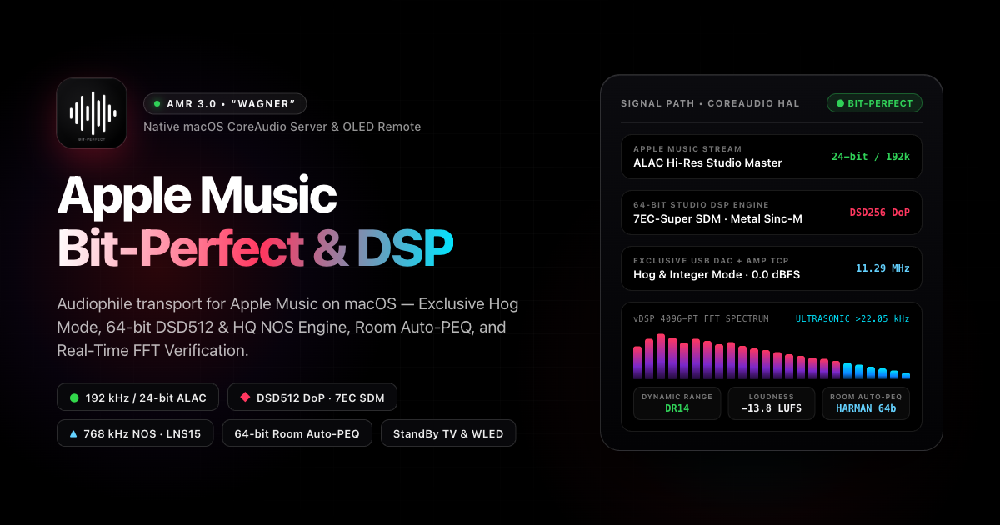

  

# Apple Music Remote 3.0.0 — "Wagner"

**v3.0.0 ("Wagner")** is our biggest milestone release yet — introducing a reference **Hybrid 64-Bit Studio DSP Engine** with `CoreAudio Exclusive Hog Mode` (`DSD64–DSD512 DoP` via 7th-order `7EC` + Viterbi Trellis, and `HQ PCM NOS` up to `768 kHz` with `AMX FP64` 65k / `Metal GPU df64` 262k Sinc filters & `LNS15` noise shaping), **64-Bit Room Acoustic `Auto-PEQ`** measured straight from your iPhone / iPad microphone, real-time **Mastering Telemetry (`TT DR`, `EBU R128 LUFS`, `4x ISP`, `Phase`)**, **Pre-DSP Mastering Restoration (`De-Clipper` & `Weiss Dynamic De-Esser`)**, **Audiophile `Late-Night DRC`**, **Apple Neural Engine `Sonic Bridge`** (`512-D SLERP` trajectory routing), **Two-Way iCloud Drive Sync**, a **sub-second Direct Cloud Hi-Res Engine** with zero library pollution, a **Zero-Keychain `AES-256-GCM` Vault**, **Apple Developer ID Signing & Notarization**, **100% English & Russian Localization**, and **410+ automated Swift unit tests**.

---

## 🎛 1. Hybrid 64-Bit Studio DSP Engine & CoreAudio Exclusive `Hog Mode`
* **Lock-Free Exclusive Hardware Pipeline (`AudioEngineController` + `CoreAudioDeviceManager`)**:
  * Captures `Music.app` via `AudioProcessTapService` (`.muted`) and drives external USB DACs directly through a dedicated `AudioDeviceIOProcID` under `kAudioDevicePropertyHogMode` + `Non-Mixable Integer (0x4c)`, powered by `SPSCAtomicRingBuffer` and `RealtimeMachWorker` with zero allocations on the real-time audio thread.
  * Instant 1-click return to **`100% Bit-Perfect Passthrough (Off)`** with native source clock restoration (`44.1 – 192 kHz`).
* **7th-Order `7EC` Sigma-Delta DSD Modulator (`DSD64 / DSD128 / DSD256 / DSD512 DoP`)**:
  * Three NTF profiles (`7EC-Transient`, `7EC-Balanced`, `7EC-Super`), parallel **Viterbi Trellis lookahead (`M = 4 / 8 / 16`)**, Inter-Symbol Interference (`ISI`) regularizer, and lossless DoP v1.1 (`0x05 / 0xFA`) framing.
* **Synchronous `2x–16x` Oversampling & `HQ PCM NOS` up to `705.6 / 768 kHz`**:
  * **`Accelerate AMX FP64` (`65,536` taps)** and **`Metal GPU Overlap-Save df64` (`262,144` taps)** Linear-Phase and Minimum-Phase Sinc filters.
  * **`HQ PCM NOS` Mode** for discrete R2R / Multibit ladder and Hi-Res PCM DACs with a **15th-order psychoacoustic `LNS15` noise shaper** (`< -165 dBFS` audible noise floor, 27+ effective bits).
* **3-Stage USB DAC Hardware Verifier & DSP Presets (`DSPPresetManager`)**:
  * Automatically validates bus type, bit depth (`≥ 24-bit`), and supported sample rates — preventing `DSD DoP` / `NOS` activation on built-in Mac speakers, AirPlay, Bluetooth, HDMI, or 16-bit headsets, and automatically suspending USB `Hog Mode` when streaming Bit-Perfect `24/192` LPCM to **BluOS / DLNA** network players.

---

## 📐 2. 64-Bit Room Acoustic Correction (`Auto-PEQ` via iPhone / iPad Mic)
* **In-Browser Listening-Spot Calibration (`RoomAcousticService` + `RoomEQProcessor`)**:
  * Plays calibrated semi-correlated Paul Kellet pink noise (`20 Hz – 20 kHz`) through your speakers (local USB DAC or `BluOS / DLNA`) while recording from your iPhone or iPad directly in the Web PWA (`WebAudio` + native iOS capture fallback over plain LAN HTTP).
  * Computes a 31-band ISO 1/3-octave Welch–Hann `4096-pt vDSP FFT` spectrum with iOS MEMS microphone compensation, detects standing room modes (`35–220 Hz`), plots **Measured vs. Harman In-Room Target vs. Corrected** curves in the *Signal Path* inspector, and synthesizes up to 8 asymmetric `Float64` minimum-phase RBJ biquad filters with automatic negative `Preamp Headroom`.

---

## 📊 3. Mastering Telemetry, Pre-DSP Restoration & `Late-Night DRC`
* **Live Mastering Diagnostics (`SpectralIntegrityAnalyzer`)**:
  * Real-time **TT Dynamic Range (`DR4–DR16+`)**, **EBU R128 (`Integrated & Short-Term LUFS`, `LRA`)**, **4× Oversampled `True Peak (dBTP)` & ISP Clipping Guard**, and **Stereo Phase Correlation (`-1..+1`)**, plus **Psychoacoustic Crest Compensation** and **`[Music.app SC Guard]`** for external TCP amplifier SoundCheck.
* **Pre-DSP Mastering Restoration (`MasteringRestorationService`)**:
  * **Loudness-War `MasteringDeClipper`**: Adaptive brickwall ceiling tracker + 256-sample look-ahead Cubic Hermite `C1` peak reconstruction (up to `+4.2 dB`), with **`Auto — Smart Guard`** automatically bypassing dynamic audiophile masters (`DR11+`).
  * **Weiss-Style Dynamic De-Esser (`WeissDynamicDeEsser`)**: Level-independent sibilance-to-body ratio detector (`6.5–7.0 kHz` vs `> 180 Hz`) with zero-phase symmetric RBJ subtraction (`100% Bit-Exact` between sibilants).
* **Audiophile `Late-Night DRC` & Seamless `Repeat One`**:
  * 64-bit dual-envelope `ITU-R BS.1770` dynamic range controller (`Gentle` and `Night Concert` profiles) featuring a `-63 dBFS` tape-hiss gate and a 64-sample `-1.0 dBTP` look-ahead limiter, plus three-state repeat cycling (`Off → Repeat All → Repeat One 🔂`).

---

## 🌉 4. AI `Sonic Bridge`, Playlists vs. Library Split & Sub-Second Cloud Engine
* **🌉 Sonic Bridge (`NativeMusicCuratorService+SonicBridge`)**:
  * Computes a smooth `10 / 12 / 16`-step geodesic musical route from **Point A** to **Point B** (tracks, artists, or moods) via spherical linear interpolation (`SLERP`) in 512-D `NLEmbedding` space on Apple Neural Engine.
* **Dedicated `Playlists` & 4-Tab `Library` Architecture**:
  * Independent **Playlists** view (`+ Save to Playlists` with `0 ms` optimistic insertion) alongside a 4-tab **Library** (**Recent / Artists / Albums / Songs**), full library deletion (`removeTrack`, `removeAlbum`, `removeArtist`, `removePlaylist`), **Album Completeness Detector** (`Saved X of Y` with 1-tap catalog completion), and customizable **TV Mode Library tiles**.
* **Sub-Second Direct Cloud ALAC/Hi-Res Engine (`0.5–0.9 s`) & Zero Library Pollution**:
  * Starts Apple Music cloud catalog streams in **`0.5–0.9 s`** in native **ALAC Lossless / Hi-Res up to `192 kHz / 24-bit`** using a single reusable staging buffer (`play once=true`) with vectorized `~1.5 ms` Shuffle/Queue staging, automatic crash-orphan cleanup, and in-memory RFC 1952 `gzip` PWA asset delivery (`907 KB → 149 KB`).

---

## ☁️ 5. iCloud Drive Sync, Zero-Keychain Vault & Apple Notarized Universal DMG
* **Two-Way iCloud Drive Sync (`CloudSettingsSyncService`) & Granular Device Permissions**:
  * Automatically syncs DSP presets, Room `Auto-PEQ` profiles, Late-Night DRC preferences, and `SoundCheck / DR / LUFS` caches across Macs via `NSFileCoordinator` + `NSMetadataQuery`, plus per-device PWA capability toggles (`DAC`, `DSP`, `Room EQ`, `Late-Night DRC`) and `< 50 ms` hardware volume control for `BluOS` and `DLNA`.
* **Signed, Apple Notarized & Zero-Keychain Security**:
  * Signed with **Apple Developer ID** and **Notarized & Stapled by Apple** for frictionless installation on macOS Sonoma & Sequoia.
  * Replaced legacy macOS Keychain calls with a dedicated local `CryptoKit` **`AES-256-GCM`** encrypted vault (`0700`/`0600`) — eliminating intrusive macOS Keychain password dialogs on launch and upgrade.
* **100% Bilingual Localization (`EN / RU`) & 410+ Automated Tests**:
  * Full English localization across every native macOS window, menu, diagnostic message, and Web PWA screen, backed by **410+ passing `swift test` unit tests**.

---

## 📦 Installation
1. Download **`AppleMusicRemoteMac-Universal.dmg`** below (Universal 2 binary for **Apple Silicon M1–M4** and **Intel `x86_64`**, macOS 14.0+).
2. Open the `.dmg` and drag **`AppleMusicRemoteMac.app`** to **`/Applications`**.
3. Launch the app from `/Applications` and grant permission to control `Music.app` when prompted.
